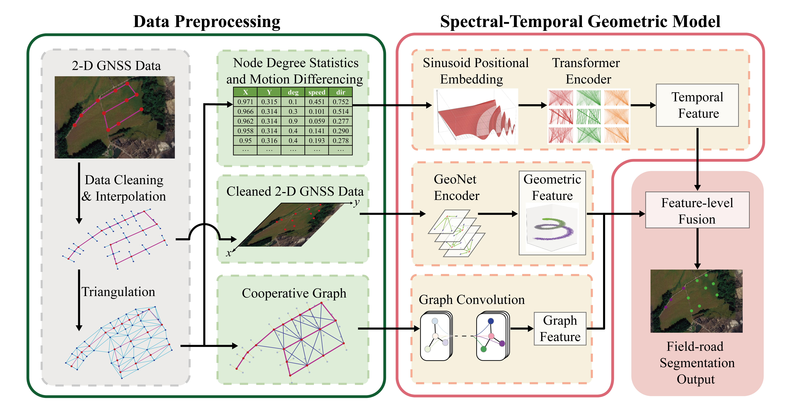
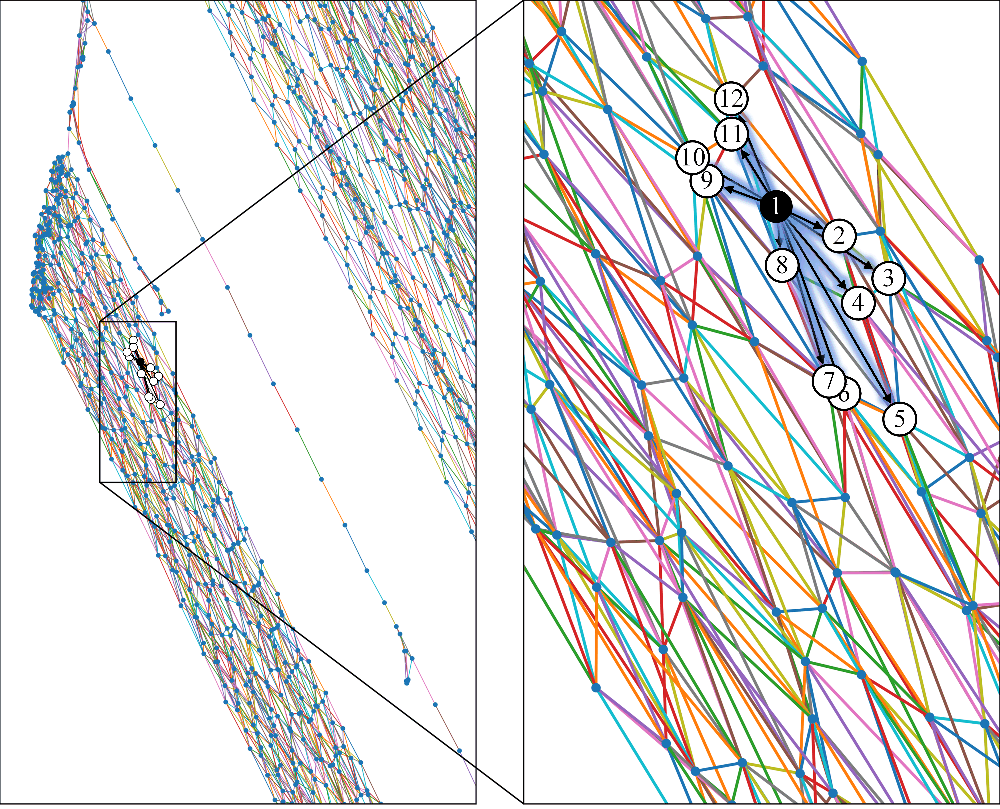
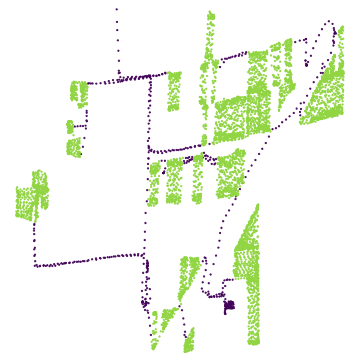
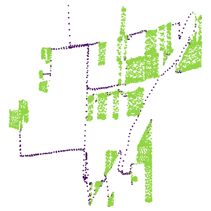

# ST-GeoNet

Research code for **ST-GeoNet: A spectral-temporal geometric neural network for field-road segmentation of agricultural machinery trajectory**.

ST-GeoNet assigns a field-operation or road-driving label to each point in an agricultural machinery GNSS trajectory. It combines trajectory geometry, cooperative-graph relationships, and temporal context. The manuscript evaluates the method on the PAAPDSP, Harvester, and BPMAMIUOCS datasets.

Python modules and the main class use `ST_GeoNet`; the geometric branch is called **GeoNet**.

## Workflow



*Workflow from the accompanying manuscript. ST-GeoNet combines geometric features, cooperative-graph features, and temporal features to predict a field-operation or road-driving label for each trajectory point.*

Use the following files to follow the workflow in code:

| Workflow stage | Code entry point |
| --- | --- |
| Stationary-point removal and sampling | [Sampling/Usample.py](Sampling/Usample.py) |
| Cooperative graph and degree preparation | [gen_feature&graph.py](Graph%26degree_gen/gen_feature%26graph.py), using [triNEAUfunc.py](Graph%26degree_gen/triNEAUfunc.py) |
| Feature selection, padding, and adjacency loading | [ST_GeoNet_util.py](ST_GeoNet_util.py), `load_data()` |
| Three branches, feature fusion, and decoding | [ST_GeoNet_model.py](ST_GeoNet_model.py), `ST_GeoNet.forward()` |
| Training and evaluation | [main.py](main.py), `train()` and `test()` |

## Model

The three branches operate in parallel with the following default dimensions.

| Component | Implemented operation | Output per point |
| --- | --- | --- |
| GeoNet | A learned 3-by-3 spatial transform and three dynamic EdgeConv blocks, starting from `[x, y, 0]` | Three 64-channel local features and a broadcast 1,024-channel global feature |
| Graph branch | Three graph-convolution layers using the prepared adjacency matrix | 32 channels |
| Temporal branch | Projection to 32 channels, positional encoding, and three Transformer encoder layers with four attention heads | 32 channels |
| Fusion and decoder | Concatenation to 1,280 channels; point-wise layers of widths 256, 256, and 128; final class projection | Two logits |

The output shape is `(batch_size, num_points, 2)`. Cross-entropy operates directly on the logits; `argmax` over the final dimension gives the predicted class.

By default, the model uses **six input channels `[x, y, 0, distance_norm, angle_norm, degree]`**. The zero-valued third coordinate completes the spatial-transform input. Optional numeric attributes can be selected by name with `--extra_features`, and `--motion_source csv` uses the CSV speed and direction values instead of deriving motion features from coordinates.

With `K` selected extra attributes, the input order is `[x, y, 0, motion_1, motion_2, extra_1, ..., extra_K, degree]`, with `6 + K` channels. GeoNet always receives only the first three channels. The first layers of the graph and temporal branches adapt to the full input width; their output widths, the 1,280-channel fusion, and the two-class output remain unchanged.

## Files

```text
ST-GeoNet/
├── main.py                         # Training, evaluation, arguments, and logging
├── ST_GeoNet_model.py               # ST-GeoNet and neural components
├── ST_GeoNet_data.py                # TrajectoryDataset and augmentation helpers
├── ST_GeoNet_util.py                # Data loading, adjacency preparation, loss, metrics
├── trajectory_schema.py            # Shared CSV layout and input-feature configuration
├── masked_batchnorm.py             # Batch-normalization wrappers
├── requirement.txt                 # Direct Python dependencies
├── readme.md
├── assets/                        # Manuscript illustrations used in this README
├── Sampling/Usample.py             # Stationary-point removal and sampling
├── Graph&degree_gen/
│   ├── gen_feature&graph.py         # Feature and cooperative-graph preparation
│   ├── triNEAUfunc.py               # Projection and triangulation utilities
│   └── Degree_data/                # Prepared train/test data
└── outputs/ST_GeoNet_clear/
    └── 9486_best_model.t7     # Supplied model state dictionary
```

## Environment

Use Python 3.9 and install the seven dependencies listed in `requirement.txt`.

```text
conda create -n st_geonet python=3.9
conda activate st_geonet
python -m pip install --upgrade pip
python -m pip install -r requirement.txt
```

For GPU execution, install a PyTorch 2.0.1 build and NVIDIA driver compatible with the target CUDA environment.

## Prepared data

### Download the trajectory data

The trajectory CSV files are provided separately in [release v1.0.0](https://github.com/NEAU-MaLab/ST-GeoNet/releases/tag/v1.0.0).
Download `ST-GeoNet-data-v1.0.0.zip` and extract it into the project root, preserving its directory structure. The archive contains the CSV files under `Sampling/` and `Graph&degree_gen/`, including the prepared feature and graph pairs. The supplied model checkpoint is included in the repository under `outputs/ST_GeoNet_clear/`.

For example, after downloading the archive into the project root:

```text
python -m zipfile -e ST-GeoNet-data-v1.0.0.zip .
```

The release includes a `SHA256SUMS.txt` file for checking the downloaded archive. Data is distributed separately so that cloning the source repository does not download all trajectory files.

Pass a directory containing `train/Feature`, `train/Graph`, `test/Feature`, and `test/Graph` through `--data_path`. Each sample needs one feature CSV and one graph CSV. The graph filename is obtained by replacing lowercase `feature` with `graph` in the feature filename. Filenames without that substring are identical in both directories.

Every trajectory CSV includes a saved index followed by a fixed prefix, optional extra attributes, and a fixed suffix. `trajectory_schema.py` validates this layout. The column names after the index must be unique and match the required spelling.

| CSV section | Required layout |
| --- | --- |
| First column | Saved point index, for example `point_id` or an unnamed pandas index |
| Fixed prefix | `Gauss_X,Gauss_Y,longitude,latitude,speed,direction` |
| Optional middle block | Additional numeric columns immediately after `direction` |
| Raw or sampled suffix | `time,tag` |
| Prepared feature suffix | `time,degree,tag` |

Without extra attributes, the complete raw/sampled header is:

```text
point_id,Gauss_X,Gauss_Y,longitude,latitude,speed,direction,time,tag
```

The corresponding prepared feature header is:

```text
point_id,Gauss_X,Gauss_Y,longitude,latitude,speed,direction,time,degree,tag
```

- `point_id` is a unique integer identifier referenced by graph edges. An unnamed first header cell is valid for the index written by pandas.
- `Gauss_X` and `Gauss_Y` contain the two coordinates normalized by the preparation script.
- Geographic coordinates and source motion attributes are retained; `time` must already be numeric in the prepared feature file.
- `degree` is the graph-derived attribute, and `tag` is the class label: `1` for field operation and `0` for road driving.
- Keep the fixed prefix and suffix in the specified order. Extra attributes are selected by their column names. Keep rows in trajectory order and preserve point identifiers.

### Motion attributes and normalization

`--motion_source derived` is the default. The loader derives the first motion attribute from the Euclidean distance to the following point in normalized coordinate space, and the second from the `atan2` direction of that segment. The final point repeats the preceding distance and angle. The distance attribute is a displacement proxy; it is not divided by elapsed time.

With `--motion_source csv`, the loader takes the existing `speed` and `direction` columns instead. This option changes the source of the two motion attributes, not their number. They are still normalized before entering the network.

Each of the two motion attributes and each selected extra attribute is independently min-max normalized within the current trajectory:

```text
normalized_value = (value - column_min) / (column_max - column_min)
```

Each column has its own minimum and maximum. A column whose range is less than `1e-6` becomes zero. Selected motion and extra attributes must be numeric and finite; NaN or infinity causes an error. Coordinate scaling and the prepared `degree` feature follow the existing preprocessing rules and are not changed by selecting extra attributes.

### Adding numeric attributes

Supply extra attributes as numeric columns between `direction` and `time`. For example, a complete raw/sampled CSV header containing acceleration and angular acceleration is:

```text
point_id,Gauss_X,Gauss_Y,longitude,latitude,speed,direction,angular_acceleration,acceleration,time,tag
```

The corresponding prepared feature header is:

```text
point_id,Gauss_X,Gauss_Y,longitude,latitude,speed,direction,angular_acceleration,acceleration,time,degree,tag
```

The sampling and graph-generation scripts preserve all extra columns with their corresponding retained rows. They do not calculate acceleration, angular acceleration, or other extra attributes, and they do not recompute them after sampling. Provide their numeric values before preprocessing, using consistent definitions and units for training and evaluation.

Extra columns can appear in any order within their middle block. Select them explicitly in the desired **network input order**:

```text
--extra_features acceleration angular_acceleration
```

For the example CSV above, this selects `acceleration` before `angular_acceleration`, despite their reversed CSV order. The resulting default-motion input is `[x, y, 0, distance_norm, angle_norm, acceleration_norm, angular_acceleration_norm, degree]`, with eight channels. The same ordered selection is required when loading the trained model.

Omitting `--extra_features` selects no extra attributes. Additional columns remain in the CSV but do not enter the network, so the input remains six-dimensional. Every selected name must exist in each relevant feature CSV, and names in the selection must be unique. Fixed columns, including `speed`, `direction`, `time`, `degree`, `tag`, coordinate columns, and index names, cannot be selected as extras. Use `--motion_source csv` to choose the existing speed and direction columns.

### Graph files and sample size



*Cooperative graph example from the manuscript. Blue points are original trajectory points. Graph edges connect points within and across neighboring working paths. The enlarged region highlights center point 1 and its selected neighbors, numbered 2 to 12.*

[gen_feature&graph.py](Graph%26degree_gen/gen_feature%26graph.py) exports the graph shown conceptually above as pairs of point identifiers. [ST_GeoNet_util.py](ST_GeoNet_util.py) converts these pairs into the adjacency matrix used by `GCNBackbone` in [ST_GeoNet_model.py](ST_GeoNet_model.py).

Graph CSVs have **no header** and contain two integer point identifiers per row:

```text
0,1
1,2
0,2
```

All endpoints must occur in the matching feature CSV. The loader maps identifiers to row positions, symmetrizes the graph, adds self-loops, and applies row normalization. Features and edges must describe the same sampled points.

Graph files must contain at least two edge rows. Prepare samples with at least two points and at most `--num_points` points, which defaults to 4,096. Short samples receive zero-padded features, labels of `-1`, and a validity mask. Loss and reported metrics exclude labels of `-1`. Sample oversized trajectories and generate their matching graphs before loading.

**Memory requirement:** all adjacency matrices are materialized as dense tensors when the dataset loads. A 4,096-by-4,096 float32 matrix uses about 67.1 MB. The 864 training pairs and 368 test pairs require approximately **58.0 GB and 24.7 GB**, respectively, for adjacency tensors alone. Training loads both partitions; intermediate arrays and model activations need additional memory. Use a smaller set of paired files when system memory is limited. Reducing batch size does not remove the full-dataset loading cost.

## Preparing trajectories

The preprocessing scripts have editable settings near the top. Their default paths are anchored to their script or project locations, so the commands below can be run from the project root.

1. Supply indexed CSVs with the raw layout above, including projected coordinates before sampling. Place any numeric extra attributes after `direction` and before `time`.
2. Configure `mode` and folders in `Sampling/Usample.py`. It removes points whose recorded speed is zero. Long trajectories produce several overlapping sampled files.
3. Configure the input folder, partition, and width in `Graph&degree_gen/gen_feature&graph.py`. The default working width is `width = 6` metres. Graph construction uses projected coordinates; coordinates and degree are normalized afterward.
4. Match the sampling output folder to the graph-generation input folder, and set the target data partition. The retained default `mode` is `test` in the sampling script and `width_6_test` in the graph-generation script, so configure these paths to refer to the same sampled data. The graph-generation script exports a feature CSV and a graph CSV for each trajectory and preserves the optional extra columns.

After configuring the scripts, run them from the project root:

```text
python Sampling/Usample.py
python "Graph&degree_gen/gen_feature&graph.py"
```

## Training and evaluation

Run the following commands from the project root. The default dataset root is `Graph&degree_gen/Degree_data` within the project. Relative `--data_path` and `--model_path` values are resolved against the project root, and outputs are written under the project's `outputs` directory. Absolute paths are also supported.

Training starts from new weights unless `--model_path` is provided. Evaluation requires a checkpoint path. The examples use a prepared dataset at `data/ST_GeoNet_extra` and run one training epoch; set `--epochs` to the intended duration for your experiment.

### Default six-channel input

Extra columns in the CSV are ignored unless selected. The supplied six-channel checkpoint can be evaluated with the default derived motion attributes:

```text
python main.py --exp_name ST_GeoNet_default --data_path data/ST_GeoNet_extra --batch_size 2 --test_batch_size 1 --epochs 1
python main.py --eval True --exp_name ST_GeoNet_default_eval --data_path data/ST_GeoNet_extra --model_path outputs/ST_GeoNet_clear/9486_best_model.t7 --test_batch_size 1
```

### Two additional attributes

The training command selects acceleration and angular acceleration in that order. Evaluation uses the same ordered feature selection:

```text
python main.py --exp_name ST_GeoNet_extra --data_path data/ST_GeoNet_extra --extra_features acceleration angular_acceleration --batch_size 2 --test_batch_size 1 --epochs 1
python main.py --eval True --exp_name ST_GeoNet_extra_eval --data_path data/ST_GeoNet_extra --extra_features acceleration angular_acceleration --model_path outputs/ST_GeoNet_extra/models/epoch_0_model.t7 --test_batch_size 1
```

### Motion attributes from the CSV

These commands use the CSV `speed` and `direction` columns without selecting extras. The input still has six channels, but its motion configuration differs from the default checkpoint:

```text
python main.py --exp_name ST_GeoNet_csv_motion --data_path data/ST_GeoNet_extra --motion_source csv --batch_size 2 --test_batch_size 1 --epochs 1
python main.py --eval True --exp_name ST_GeoNet_csv_motion_eval --data_path data/ST_GeoNet_extra --motion_source csv --model_path outputs/ST_GeoNet_csv_motion/models/epoch_0_model.t7 --test_batch_size 1
```

`--motion_source csv` can also be combined with `--extra_features`; supply both options identically during training and evaluation. In the examples that load newly trained weights, replace `epoch_0_model.t7` with the checkpoint actually saved by the corresponding run and keep its feature-configuration JSON beside it.

For these batch-size-2 training examples, use at least two training samples and an even number of samples. The spatial-transform batch-normalization layers require more than one trajectory in each training batch, including the last batch; evaluation can use batch size 1. With multiple GPUs, each device's training batch must also contain more than one trajectory. The full-dataset adjacency memory requirement described above still applies.

The program selects an available CUDA device and falls back to CPU when CUDA is unavailable. Append `--no_cuda True` to request CPU execution. Boolean arguments accept explicit `True` and `False` values, for example `--use_sgd False` to select Adam. An experiment name does not enable or disable branches. For fine-tuning, add `--model_path` to the training command; loading model weights does not restore optimizer state.

| Argument | Default | Meaning |
| --- | --- | --- |
| `--num_points` | `4096` | Padded trajectory length |
| `--extra_features` | Empty list | Ordered names of additional numeric CSV attributes |
| `--motion_source` | `derived` | Motion attributes derived from coordinates; alternative: `csv` |
| `--k` | `55` | GeoNet nearest neighbors |
| `--emb_dims` | `1024` | Global geometric feature width |
| `--graph_feature_dims` | `32` | Graph feature width |
| `--dropout` | `0.5` | Graph-branch and decoder dropout |
| `--epochs` | `4000` | Training epochs |
| `--batch_size` / `--test_batch_size` | `18` / `1` | Trajectories per batch |
| `--use_sgd` | `True` | SGD; the alternative is Adam |
| `--lr` | `0.0001` | Base rate; SGD multiplies it by 100 |
| `--scheduler` | `cos` | Cosine scheduler; alternative: `step` |

Keep `--num_points` between `--k` and 4096, the positional-encoding capacity. Keep architecture settings compatible with the checkpoint and the fixed 1,280-channel decoder input. Keep `--T_D_point_cloud False` to use the complete ST-GeoNet feature input, including any selected extras.

## Outputs and checkpoint compatibility

Messages are appended to the project's `outputs/<exp_name>/run.log`. Training evaluates every five epochs, including epoch 0. When accuracy improves, `save_checkpoint()` writes the model state dictionary and its feature configuration as a pair:

```text
outputs/<exp_name>/models/epoch_<epoch>_model.t7
outputs/<exp_name>/models/epoch_<epoch>_model.t7.features.json
```

The `.t7` file retains the original PyTorch state-dictionary format. The accompanying JSON records the selected feature names and order, motion source, and input configuration. Optimizer and scheduler states are not saved, so loading these files does not resume the complete previous training state.

Metrics pool valid points from the evaluated partition. `pre`, `rec`, and `f1` describe label 1; `_n` fields describe label 0. The log also gives overall accuracy and training balanced accuracy (`train avg acc`). Evaluation reports metrics but does not export per-trajectory prediction CSVs.

`load_checkpoint()` maps tensors to the selected device, handles the `module.` prefix used by `DataParallel`, and loads with strict parameter-name and shape checks. It also checks the requested input configuration against the accompanying JSON. Changing extra-feature order is a configuration mismatch even when the number of channels stays the same.

| Checkpoint configuration | Loading requirement |
| --- | --- |
| Default six channels with derived motion | A legacy checkpoint without JSON is accepted; if JSON is present, its configuration must match |
| One or more extra attributes | Matching `.t7.features.json` is required |
| CSV motion attributes, with or without extras | Matching `.t7.features.json` is required |

The bundled `9486_best_model.t7` can be used with no extras and `--motion_source derived`. Adding channels requires training a model with the corresponding input width from scratch. Likewise, CSV-motion evaluation requires weights trained with that motion configuration, even when the input still has six channels. Loading never silently trims weights, fills missing input weights, or accepts a different feature order.

When copying a newly trained model to another folder or machine, copy **both** the `.t7` file and its `.t7.features.json` file, keeping the filenames paired. Use the same ordered `--extra_features` and the same `--motion_source` when loading. For example, `epoch_0_model.t7.features.json` must be beside `epoch_0_model.t7`. Do not replace the JSON with one from a differently configured experiment.

## Segmentation example

| Ground truth | ST-GeoNet prediction |
| :---: | :---: |
| [](assets/ground_truth.png) | [](assets/st_geonet_prediction.png) |

*Ground-truth annotations and ST-GeoNet predictions for the same sample trajectory from the manuscript. Green denotes field operation; purple denotes road driving.*

`ST_GeoNet.forward()` in [ST_GeoNet_model.py](ST_GeoNet_model.py) returns two logits per point. Taking `argmax` over the class dimension gives the labels represented by these colors. The `test()` function in [main.py](main.py) evaluates predictions on valid points; the images above illustrate the manuscript results.

## Paper and datasets

The accompanying manuscript is *ST-GeoNet: A spectral-temporal geometric neural network for field-road segmentation of agricultural machinery trajectory*, by Wenchuan Ma, Qiheng Wu, Ziyu Huang, Jinling Wang, Xi Chen, Yifan Li, Ruinian Li, Xuanbin Xu, Yujian Bao, and Zhongbin Su. Publication details can be added when available.

Dataset sources listed in the manuscript:

- [BPMAMIUOCS](https://github.com/NEAU-MaLab/BPMAMIUOCS-Dataset)
- [PAAPDSP](https://github.com/AgriMachineryBigData/Field-road_mode_mining)
- [Harvester](https://github.com/Agribigdata/dataset_code)

Prepare each dataset using the CSV format described above.
## License

The source code is distributed under the [MIT License](LICENSE). Use of the datasets remains subject to the terms of their original providers listed above.
